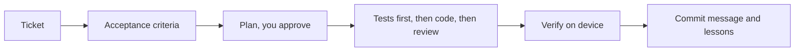

<h1 align="center">Doer Work Kit</h1>

<p align="center"><b>Ticket in. Tested code out.</b></p>

<p align="center">
  A Claude Code plugin that takes a ticket from acceptance criteria to a clean, reviewed commit, and stops before anything ships.
</p>

<p align="center">
  
  
  
  
</p>

Doer (`wk`) is four commands for the daily work of a developer in Claude Code.
Give it a ticket and it writes the acceptance criteria, plans with you, writes
the tests first, builds until they pass, has it reviewed, checks it on a real
device, and hands you a commit message. You approve every step that matters.
It never pushes.



## Four commands. Every kind of work.

**`/wk:doer`: planned work.** A feature, a refactor or a planned bug goes from
ticket to implementation-ready code on its own branch, in 5 stages. Tests come
first, a reviewer checks every round, and the suite has to be green before it
moves on.

**`/wk:bugfix`: reported bugs.** Point it at a Jira ticket. It pulls the
ticket, the comments and any network captures, investigates in plan mode and
reaches a verdict. A real app bug gets fixed and verified on device. Not the
app's fault? You get an evidence-first write-up ready for Jira.

**`/wk:replay`: reproduce the impossible.** Force a captured network response,
or a feature flag, into the app's own code, so a bug shows up on your device
whatever the backend says today. One command removes every trace.

**`/wk:protologs`: see what really runs.** Temporary debug logs across the
path of your change, so you watch the real flow on a device. One command
removes every line.

**Rule of thumb:** planned work goes to `doer`, reported bugs to `bugfix`,
`replay` reproduces what your environment can't, and `protologs` is how you
check it on device.

## Get started

```bash
claude plugin marketplace add https://github.com/icarloscornejo/doer.git
claude plugin install wk@wk
```

Then, inside Claude Code, once:

```
/wk:setup
```

It asks three things, all optional: the language for chat narration, your Jira
URL for this project, and the name of the env var that holds your Jira token.
Then start a ticket:

```
/wk:doer ABC-123
```

Working on a branch that merges straight to its base branch, with no PR? Add
`--no-pr`: `/wk:doer ABC-123 --no-pr` (works for `/wk:bugfix` too).

Close the session whenever you want: every step is saved. Run the same command
again and it picks up where it stopped.

## Built for the team you work with.

**Nothing internal leaks.** Ticket state lives in `.doer/`, which never
reaches git. Internal labels and debug tags never appear in commits, commit
messages or PR text: every artifact is checked before you see it.

**You stay in charge.** Your approval gates the plan. The on-device check
always asks first. Commits stay local, and pushing is always your call.

**It learns.** Each ticket can leave a lesson, and every future ticket, in any
repo, reads the ones that apply before it plans.

**Your token stays yours.** The Jira token is read from an env var and never
written to disk.

## Learn more

- [Commands in detail](docs/commands.md): setup, the 5 stages of `doer`, the 7
  stages of `bugfix`, `replay` and `protologs`, and the day-to-day commands.
- [Design and state](docs/design.md): where state lives, the design rules, and
  upgrading from 6.x.
- [Changelog](CHANGELOG.md)

---

<p align="center"><sub>Plugin version 7.19.0. MIT licensed.</sub></p>
